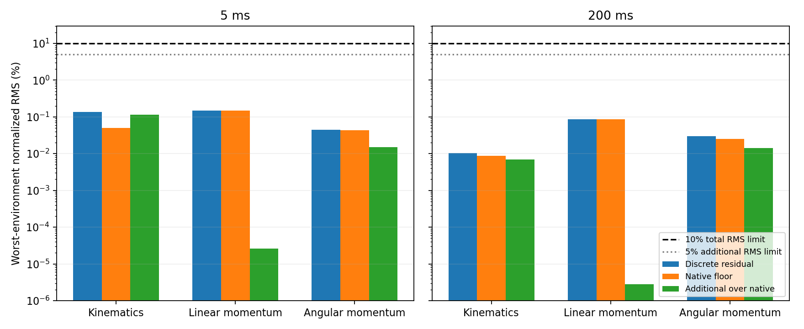

# Discrete Newton–Euler validation v1

Date: 2026-11-03. Reviewed baseline: `c7b8ab0`, branch `liquid_wrench_surrogate`.

**Decision: PASS.** The revised 5 ms and 200 ms discrete physics objectives are supported by the 200 Hz dataset within this six-case scope. All three constraints pass separately in every environment; no failing environment is hidden in a pooled result.

This evaluates recorded targets, not a trained surrogate. It establishes neither deployment-time prediction alignment, closed-loop control performance nor large-scale simulation reliability. Historical instantaneous-wrench/JVP failures and validity flags retain their original meanings.

## Scope and objective

Reused Go1/Go2 DACT × representative/high-fill/viscous trajectories: two environments per case, six seconds per environment. Settings remain 10 mm particles, four substeps (2,000 Hz native), analytic-plane fluid contacts and 5 mm softness. No collection, controller, payload-range, adapter or patched-environment settings changed; no new simulation or training was run.

The revised objective is direct SPH supervision of endpoint r/v/S and **completed 5 ms interval-average** reaction force/moment, plus short/long discrete conservation. It intentionally replaces pointwise Newton/Euler JVP constraints. The moment label is about the fixed endpoint base origin, expressed in the endpoint base frame. It is not a moving-reference moment or a forecast of the next interval.

See [equations, objective and API](liquid_discrete_constraints.md). Native measured impulses remain independent of the tested equations; forces/moments are never derived from momentum differences to force closure.

## Frozen criteria and normalization

For each horizon/channel/environment: total normalized RMS ≤10%, total p95 ≤10%, additional RMS over matched native ≤5%, additional p95 ≤10%. Require ≥100 valid 249-sample histories, ≥100 short intervals and ≥40 long windows. Empty sets are inconclusive. Criteria were frozen before evaluation and not relaxed.

`L = ||nominal interior dimensions||₂`, `F0=m|g|`, `tau0=F0 L`, `u0=sqrt(|g|L)`. Normalize r/P/H residuals by **u0 T / F0 T / tau0 T**, respectively, with actual T=5 ms or 200 ms. RMS and p95 use Euclidean vector norms. These scales differ from the historical continuous report.

## Per-environment results

All six decisions in each row (r/P/H × short/long) are PASS. Values below are normalized RMS percentages; coverage is histories / short intervals / long windows. All satisfy the independently applied p95 and additional-error criteria.

| Robot / payload / env | Coverage | 5 ms r / P / H (%) | 200 ms r / P / H (%) |
|---|---|---|---|
| go1-dact-high_fill / 0 | 949 / 948 / 909 | 0.1131 / 0.01171 / 0.01489 | 0.01012 / 0.009812 / 0.01368 |
| go1-dact-high_fill / 1 | 949 / 948 / 909 | 0.1107 / 0.006935 / 0.01488 | 0.01034 / 0.005546 / 0.01411 |
| go1-dact-representative / 0 | 949 / 948 / 909 | 0.09487 / 0.006197 / 0.01508 | 0.007388 / 0.003644 / 0.01443 |
| go1-dact-representative / 1 | 949 / 948 / 909 | 0.1089 / 0.008576 / 0.01523 | 0.008039 / 0.005545 / 0.01445 |
| go1-dact-viscous / 0 | 949 / 948 / 909 | 0.0781 / 0.1353 / 0.04209 | 0.007386 / 0.07388 / 0.02979 |
| go1-dact-viscous / 1 | 949 / 948 / 909 | 0.06978 / 0.1476 / 0.04413 | 0.007544 / 0.08705 / 0.0287 |
| go2-dact-high_fill / 0 | 949 / 948 / 909 | 0.1382 / 0.008108 / 0.01377 | 0.01047 / 0.00704 / 0.01293 |
| go2-dact-high_fill / 1 | 949 / 948 / 909 | 0.1344 / 0.004288 / 0.0124 | 0.008844 / 0.003148 / 0.01186 |
| go2-dact-representative / 0 | 949 / 948 / 909 | 0.1129 / 0.003948 / 0.01266 | 0.007182 / 0.001104 / 0.01235 |
| go2-dact-representative / 1 | 949 / 948 / 909 | 0.115 / 0.003601 / 0.01263 | 0.005824 / 0.001069 / 0.01229 |
| go2-dact-viscous / 0 | 949 / 948 / 909 | 0.08066 / 0.1276 / 0.04224 | 0.006613 / 0.07081 / 0.02833 |
| go2-dact-viscous / 1 | 949 / 948 / 909 | 0.07457 / 0.126 / 0.03845 | 0.006092 / 0.07152 / 0.02379 |

Each environment rejects 252 candidate short intervals and 252 candidate long windows while establishing valid held inputs and the causal history. The first four full intervals are held-input-ineligible, not timing/frame failures. No partial pieces or timing mismatches occur in these trajectories. Tests separately exercise asynchronous resets, split partial intervals, repeated timestamps and incomplete windows. Windows overlap and are not independent trials.

## Error attribution

Worst environment for each metric, in normalized percent (maxima can come from different environments):

| Horizon / constraint | Total RMS | Total p95 | Native RMS | Additional RMS | Frame RMS | Gravity RMS |
|---|---:|---:|---:|---:|---:|---:|
| short / kinematics | 0.1382 | 0.258 | 0.05068 | 0.1139 | 0.1139 | 0 |
| short / linear_momentum | 0.1476 | 0.2791 | 0.1476 | 2.589e-05 | 2.589e-05 | 0 |
| short / angular_momentum | 0.04413 | 0.08577 | 0.04312 | 0.01498 | 0.00147 | 0.01495 |
| long / kinematics | 0.01047 | 0.01896 | 0.008756 | 0.006965 | 0.006965 | 0 |
| long / linear_momentum | 0.08705 | 0.1384 | 0.08705 | 2.786e-06 | 2.786e-06 | 0 |
| long / angular_momentum | 0.02979 | 0.04937 | 0.02544 | 0.01439 | 4.285e-05 | 0.01439 |



- **Native floor:** independent matched endpoint momentum balances with measured coupling impulses. SPH kicks velocity, couples, then drifts; native gravity torque uses interval-start CoM positions. Native kinematics uses native endpoint-velocity trapezoids. Precomputed balance fields are only cross-checked, never used to construct the reference impulses.
- **Aggregation/frame:** compact label impulses and predicted-head-style endpoint momentum calculations versus matched native quantities. This includes the coarse endpoint-velocity quadrature error for kinematics; separate endpoint-momentum and wrench-frame components are retained in JSON.
- **Gravity quadrature:** endpoint-midpoint CoM torque approximation versus native start-position accumulation. Its vector contribution is isolated from frame error. Total-minus-native equals frame plus gravity contributions; their RMS magnitudes are not additive.
- **Precision:** all analysis uses float64 and nearby fixed recorded reference points. Casting float32 recordings cannot recover lost pose or world-origin angular-momentum precision. Small endpoint/frame differences include that storage floor.

Linear momentum residuals are dominated by the measured native floor. The additional angular error is predominantly gravity quadrature; the additional kinematic error is predominantly coarse velocity quadrature. All are below the frozen limits. **No recording-rate or physics-setting correction is required for these revised objectives in the tested scope.**

## Tests and reproducibility

Final regression run: **75 passed, 5 warnings in 5.21s** in `genesis_lr` (CPU). Includes static offset-CoM gravity torque, free fall/reaction impulses, translating/rotating frames, fixed-reference covariance, interval averaging, partial resets, masking/coverage, double-precision gradient checks through all five heads, independent gravity-reference checks and existing collector/reconstruction/containment/checkpoint tests.

```bash
MPLCONFIGDIR=/tmp/liquid-mpl /home/oyoungquist/.conda/envs/genesis_lr/bin/python \
  -m liquid_collection.discrete.analyze \
  --source runs/liquid_validation_planes10_4_20261103 \
  --output runs/discrete_newton_euler_v1_NEW --prepare-only
# Repeat with --evaluate-prepared instead of --prepare-only.

SIMULATOR=genesis_pact_water NUMBA_CACHE_DIR=/tmp/liquid-numba MPLCONFIGDIR=/tmp/liquid-mpl \
/home/oyoungquist/.conda/envs/genesis_lr/bin/python -m pytest -q \
  tests/test_liquid_discrete.py tests/test_liquid_collection.py \
  tests/test_liquid_validation.py tests/test_liquid_containment.py \
  tests/test_reconstruction_evaluation.py tests/test_go2_liquid_payload.py \
  tests/test_pact_liquid_checkpoint.py
```

- [Repository machine-readable results](liquid_discrete_validation_v1.json): every environment/channel bias, RMS, p95, maximum; all error components, coverage/rejections, criteria, source/data hashes and historical flags.
- [Detailed versioned report](../runs/discrete_newton_euler_v1_20261103_verified/report.md), [provenance](../runs/discrete_newton_euler_v1_20261103_verified/provenance.json), [frozen criteria](../runs/discrete_newton_euler_v1_20261103_verified/criteria.json), and per-case diagnostic PNGs in `runs/discrete_newton_euler_v1_20261103_verified`.
- Large native/compact trajectories remain under `runs/` and are not added to repository documentation. Raw datasets and historical reports were not modified.

To regenerate this compact document/JSON/plot: `python -m liquid_collection.discrete.publish runs/discrete_newton_euler_v1_20261103_verified --test-log /tmp/discrete-tests-final.log`.
